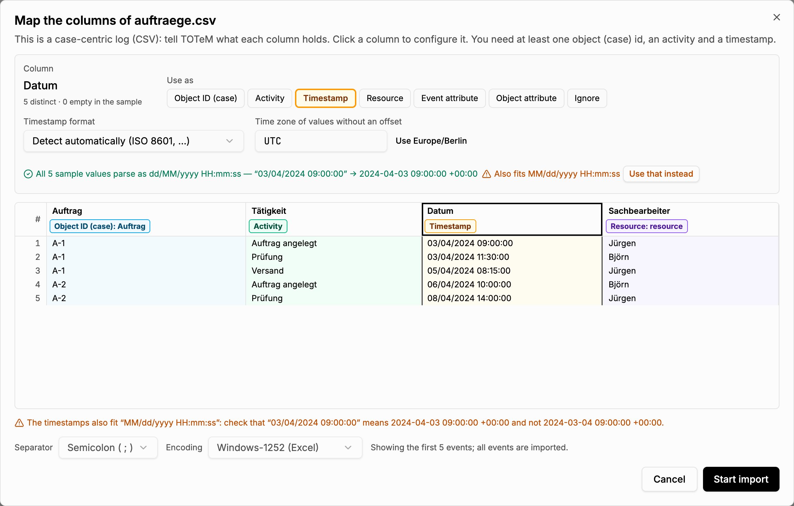
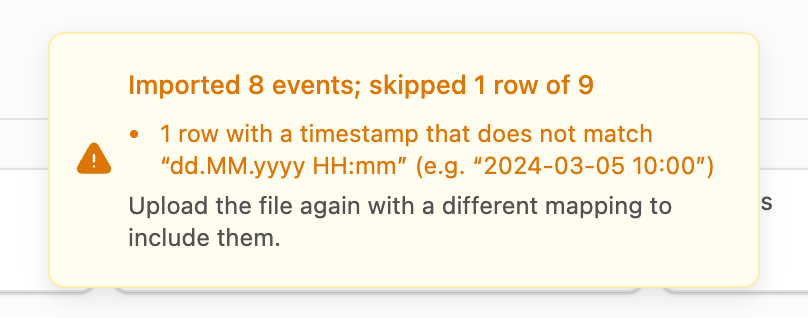
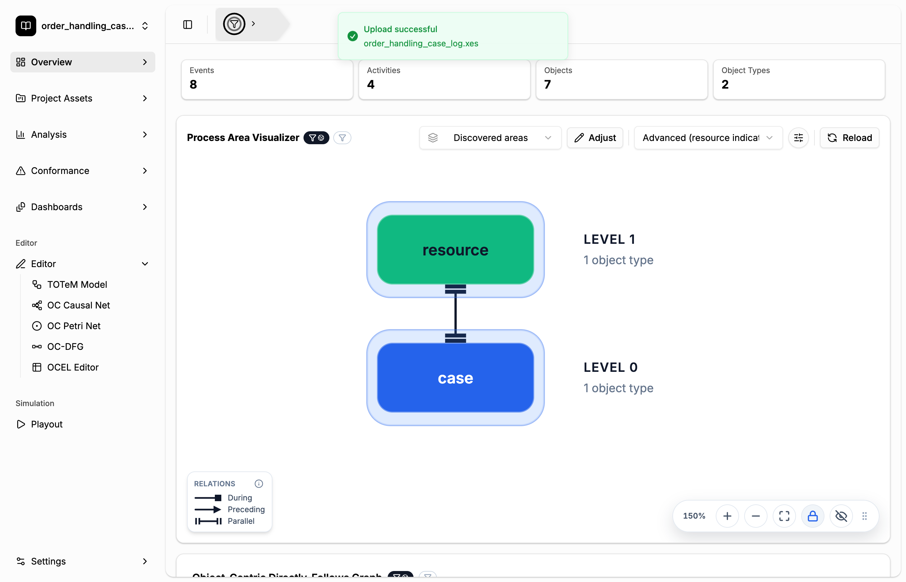

# Importing Case-Centric Logs (XES, CSV)

[← Back to the README](../../README.md#-features)

Most process mining tools export **case-centric** event logs: one table with one row per event,
where every event belongs to exactly one case. XES files (`.xes`, `.xes.gz`) and plain CSV
exports are the usual examples. Unlike an OCEL 2.0 file, such a log does not say which column
is the case, the activity or the time, so TOTeM asks you on import.

## Importing a log

1. Drag the `.xes`, `.xes.gz`, `.csv` or `.tsv` file onto **Upload a new file** and click
   **Validate & Upload**.
2. The **column-mapping dialog** opens with the first rows of the file as a table. Every column
   already has a suggested role, shown in its header.
3. Click a column to change its role in the panel above the table.
4. When the status line says **Ready to import**, click **Start import**.

An **OCEL 2.0 CSV** (with `activity` and `ot:<type>` columns) is recognised from its header and
imported directly, without the dialog.

## Column roles

| Role | What it does |
|---|---|
| **Object ID (case)** | Every distinct value becomes an object of the type you name (`case`, `order`, ...). At least one is required. Mark several id columns, say *Order ID* and *Item ID*, and each becomes its own object type, which turns a flat table into an object-centric log. |
| **Activity** | The name of the event. Several activity columns are joined with ` - ` (for example *Register order - complete*). At least one is required. |
| **Timestamp** | When the event happened, read with the format you pick. Exactly one is required. |
| **Resource** | Who did it. Stored as an object (type `resource` by default), so [Handover of Work](handover-of-work.md) and [Resource Profiling](resource-profiling.md) can use it. |
| **Event attribute** | Kept as an attribute of each event. |
| **Object attribute** | An attribute of the object in an id column, for example the customer of a case. Pick which id column it belongs to. |
| **Ignore** | Not imported. |

For XES files the standard keys are mapped for you: `case:concept:name` becomes the case
object, `concept:name` the activity, `time:timestamp` the timestamp and `org:resource` the
resource. Trace attributes appear as `case:<key>` columns and become attributes of the case
object.

The dialog lists the attributes of the events it shows. An XES attribute that first appears
further down the file is not in the list, so TOTeM keeps it anyway: a `case:<key>` attribute on
the case object, anything else on the event. It says which ones after the import. Columns you set
to **Ignore** stay ignored.

Object attributes that change over time (a status, say) are recorded in time order, even when the
file is not sorted by time. The earliest value is the object's initial one.

## Timestamp formats

Choose **Detect automatically** to let TOTeM pick, **Unix time** in seconds
or milliseconds, one of the listed patterns, or **Custom pattern...** to type your own. Patterns
use the same letters as Disco and Java: `yyyy` year, `MM` month, `dd` day, `HH` hour (24h),
`hh` hour (12h) with `a` for AM/PM, `mm` minutes, `ss` seconds, `SSS` fractions and `XXX` the
time zone. Literal text goes in single quotes (`yyyy-MM-dd'T'HH:mm`). A `strftime` pattern
such as `%d/%m/%Y %H:%M` works as well.

### Time zone

Most exports write local time without saying which zone (`01.03.2024 09:00`). Set **Time zone of
values without an offset** to where the log was recorded, for example `Europe/Berlin`. The field
suggests every zone name as you type, and a button sets your computer's zone. Summer time is
handled: 09:00 in Berlin is 08:00 UTC in March and 07:00 UTC in July. The default is UTC.

The zone applies only to values that carry no offset. A value like `2024-03-01T09:00:00+01:00`
keeps its own offset, and Unix times are absolute, so the field is disabled for them.

**Detect automatically** picks **one** format for the whole column, the one that fits most of
the first rows, and the check line names it ("parse as dd/MM/yyyy HH:mm:ss"). It never reads one
row day-first and the next month-first. Rows that do not fit the chosen format are skipped and
reported.

**Day or month first?** `03/04/2024` is 3 April in Europe and March 4 in the US. When every
sample value fits both orders, the dialog says so, shows how one value would be read either way,
and offers **Use that instead** to switch. TOTeM assumes day first until you choose otherwise.

The format is checked against the sample as you choose it, with the same parser the import
uses. A format that fits none of the values blocks the import and names an example that does not
match:

With the right one, every sample value parses and the dialog shows how the first is read:

## CSV files

The separator (`,` `;` tab or `|`) is detected from the header line. If it guessed wrong, change
it next to the status line and the table is read again. The roles you already set are kept.

The **encoding** is detected too: UTF-8, or Windows-1252 (what Excel on Windows saves as "CSV")
when the file is not valid UTF-8, and UTF-16 for Excel's "Unicode text" export. If umlauts or
accents look wrong in the table (`Pr�fung`), pick another encoding next to the separator.

Cells of any length are fine, so long notes or comments import as well.

A CSV that is already an OCEL 2.0 CSV (an `activity` column and `ot:<type>` columns) needs no
mapping and imports directly, with the same separator and encoding detection.

Column names that differ only in upper and lower case (`Status` and `status`), or that match a
built-in field (`Activity` kept as an attribute), cannot both be stored as they are. TOTeM stores
the second one as `status_2` or `Activity_attr` and says so after the import.

Events are kept in file order when they have the same timestamp. A log with dates only and no
times still shows each case's steps in the order of the file.

## What gets skipped

Rows without an activity, without a value in any object id column, or with a timestamp that
does not match the chosen format are left out. The dialog already warns when values in the
sample do not match. Rows further down the file are only seen during the import, so afterwards
TOTeM says how many rows it skipped and why, with an example of a timestamp that did not match:

To include those rows, upload the file again and pick a format that fits them. If **no** row can
be imported, the upload fails with the reason and the dialog opens again with your mapping, so you
can fix it.

After the import the log behaves like any other: TOTeM opens the overview of the new project.

