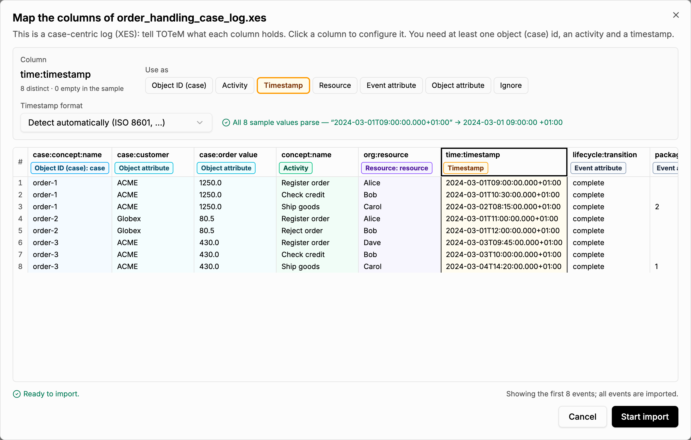
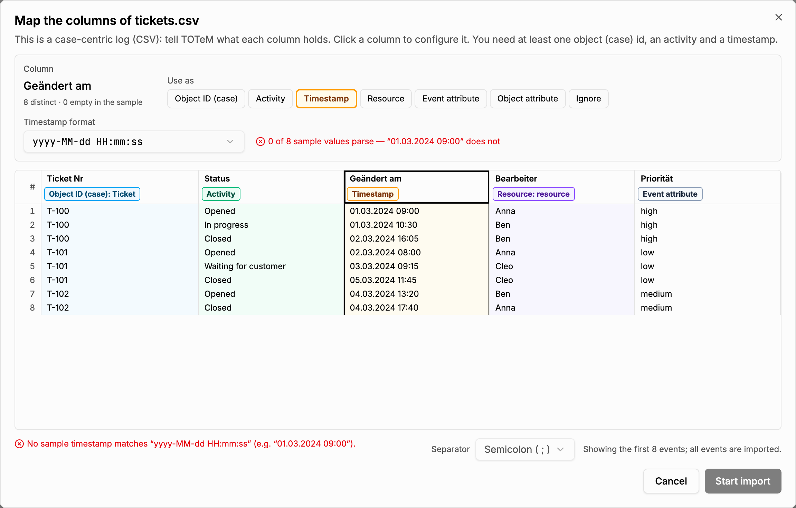
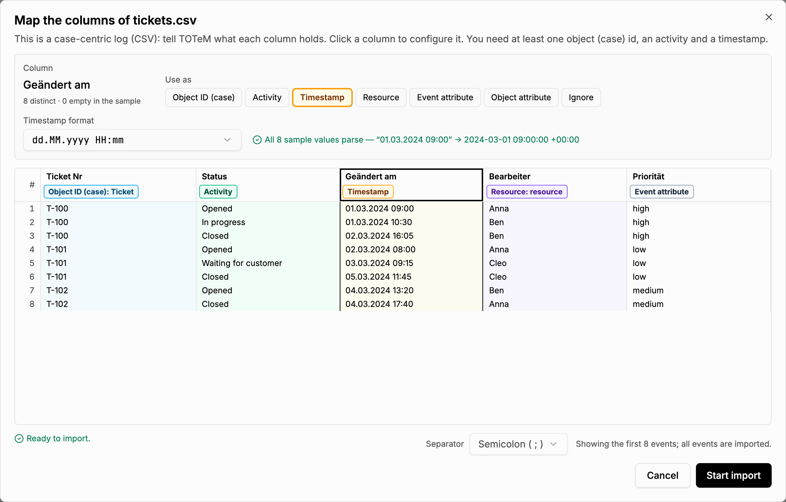

# Importing Case-Centric Logs (XES, CSV)

[← Back to the README](../../README.md#-features)

Most process mining tools export **case-centric** event logs: one table with one row per event,
where every event belongs to exactly one case. XES files (`.xes`, `.xes.gz`) and plain CSV
exports are the usual examples. Unlike an OCEL 2.0 file, such a log does not say which column
is the case, the activity or the time, so TOTeM asks you on import.

## Importing a log

1. Drag the `.xes`, `.xes.gz`, `.csv` or `.tsv` file onto **Upload a new file** and click
   **Validate & Upload**.
2. The **column-mapping dialog** opens with the first rows of the file as a table. Every column
   already has a suggested role, shown in its header.
3. Click a column to change its role in the panel above the table.
4. When the status line says **Ready to import**, click **Start import**.

An **OCEL 2.0 CSV** (with `activity` and `ot:<type>` columns) is recognised from its header and
imported directly, without the dialog.

## Column roles

| Role | What it does |
|---|---|
| **Object ID (case)** | Every distinct value becomes an object of the type you name (`case`, `order`, ...). At least one is required. Mark several id columns, say *Order ID* and *Item ID*, and each becomes its own object type, which turns a flat table into an object-centric log. |
| **Activity** | The name of the event. Several activity columns are joined with ` - ` (for example *Register order - complete*). At least one is required. |
| **Timestamp** | When the event happened, read with the format you pick. Exactly one is required. |
| **Resource** | Who did it. Stored as an object (type `resource` by default), so [Handover of Work](handover-of-work.md) and [Resource Profiling](resource-profiling.md) can use it. |
| **Event attribute** | Kept as an attribute of each event. |
| **Object attribute** | An attribute of the object in an id column, for example the customer of a case. Pick which id column it belongs to. |
| **Ignore** | Not imported. |

For XES files the standard keys are mapped for you: `case:concept:name` becomes the case
object, `concept:name` the activity, `time:timestamp` the timestamp and `org:resource` the
resource. Trace attributes appear as `case:<key>` columns and become attributes of the case
object.

## Timestamp formats

Choose **Detect automatically** for ISO 8601 and the common formats, **Unix time** in seconds
or milliseconds, one of the listed patterns, or **Custom pattern...** to type your own. Patterns
use the same letters as Disco and Java: `yyyy` year, `MM` month, `dd` day, `HH` hour (24h),
`hh` hour (12h) with `a` for AM/PM, `mm` minutes, `ss` seconds, `SSS` fractions and `XXX` the
time zone. Literal text goes in single quotes (`yyyy-MM-dd'T'HH:mm`). A `strftime` pattern
such as `%d/%m/%Y %H:%M` works as well. Times without a time zone are read as UTC.

The format is checked against the sample as you choose it, with the same parser the import
uses. A format that fits none of the values blocks the import and names an example that does not
match:

With the right one, every sample value parses and the dialog shows how the first is read:

## CSV files

The separator (`,` `;` tab or `|`) is detected from the header line. If it guessed wrong, change
it next to the status line and the table is read again. Files are read as UTF-8.

## What gets skipped

Rows without an activity, without a value in any object id column, or with a timestamp that
does not match the chosen format are left out. If **no** row can be imported, the upload fails
with the reason and the dialog opens again with your mapping, so you can fix it.

After the import the log behaves like any other: TOTeM opens the overview of the new project.

