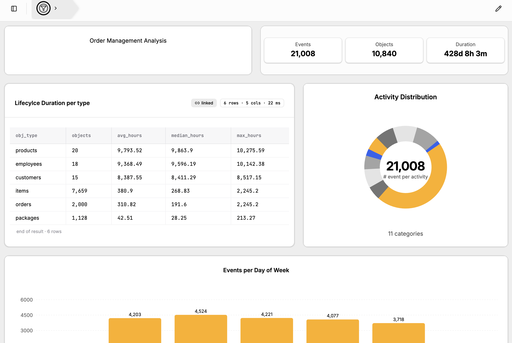
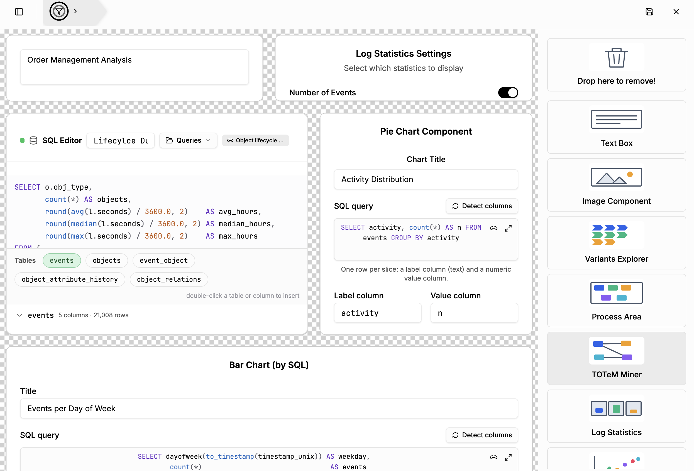

# Dashboard Creation

[← Back to the README](../../README.md#-features)

**Dashboards** combine several components on one page, for example a title, key figures, a process
model, and a few charts. You can build customized overviews for a specific question or audience.
Dashboards belong to a project and are saved with it.

## Creating a dashboard

1. In the sidebar, open **Dashboards** and click **Add Dashboard**. Enter a name.
2. Open the dashboard and click the **pencil** icon in the top right corner to enter **edit mode**.
3. Drag components from the panel on the right onto the grid, then move and resize them.
4. Click the **save** icon to store the layout, and the **×** to leave edit mode. If you leave with
   unsaved changes, the tool asks whether to keep editing or discard them.

Dashboards can be renamed, exported or deleted from the sidebar. The dashboard you are currently
looking at is highlighted in the list.

## Sharing a dashboard between projects

> To move a **whole project** — the event log, every dashboard, the models, the queries and the
> images — see [Projects](projects.md). A project file carries its own dependencies, so nothing
> needs reconnecting on the other side.

A dashboard's **structure** can be moved to another project, including one built on a different
event log.

1. In the sidebar, open the **⚙** menu next to a dashboard and choose **Export**, then choose where
   to put the `.json` file. In browsers without a save dialog (Firefox, Safari) it goes to your
   downloads folder instead.
2. Open the project you want it in, then click **Import Dashboard** under the dashboard list and
   pick the file.

The import always creates a new dashboard and never overwrites an existing one; if the name is
already taken it gets a suffix, for example `Operations (imported)`.

Only the structure travels — the layout, the components and their settings. The results are always
computed from the event log of the project you import into, so a dashboard will look different
against a different log. That is expected.

Some things cannot cross a project boundary, and the tool lists them after the import so you know
what to fix:

- **Stored SQL queries** are matched by name. If the target project has no stored query of that
  name, the widget keeps a copy of the query instead of the link. That copy may well name columns
  the new log does not have — the widget then shows the error and you can edit the query.
- **Images** are matched by name too. Without a matching image in the target project's assets, the
  image component imports empty.
- **OC Petri Net models** are matched by name as well, for the widgets that run against a saved
  net — flattened replay and object-centric alignments. Without a net of that name in the target
  project, the widget imports with no model selected and you pick one.
- **Links to other dashboards** in a Text Box only work inside one project. The words stay, the
  link is removed.
- A **dotted chart** is re-pointed at the event log you imported into, so check its axis settings.
- Widgets configured against **particular object types, activities or resources** — the variants
  explorer, a filter stack, OC Causal Net, handover and resource profiling, object-centric
  alignments — keep those names. The new log may not have them, in which case the widget shows
  nothing until you open it and pick again. The import lists the widget types affected.

Discovery components — OC-DFG, OC Causal Net, OC Petri Net, Process Areas, variants — need nothing
from the old project and work immediately.

## Edit mode

In edit mode, every component shows its settings instead of its content, for example the title and
SQL query of a chart or the statistics a *Log Statistics* tile displays. Drop a component on
**Drop here to remove!** to delete it.

Available components include:

- **Text Box** and **Image Component** (images come from the [Project Asset Store](project-asset-store.md)),
- **Log Statistics** (number of events, objects, activities, time span, …),
- analysis components: **Process Area**, **TOTeM Miner**, **OCCN**, **OC Petri Net**, **OC-DFG**,
  **Variants Explorer**, **OC Dotted Chart**, **Handover of Work**, and **Resource Profiling**,
- conformance components: **Object-Centric Alignment** (see [Object-Centric Alignments](oc-alignments.md)),
- SQL-based components: **SQL Editor**, **Pie Chart**, **Bar Chart**, **Scatter Plot**, and **KPI**.

SQL-based components can **link** a stored query from the [Project Asset Store](project-asset-store.md).
When you edit that query, every linked component updates.

### Links in a Text Box

Select some text in a Text Box, click the **link** button in the formatting toolbar, and pick what
it points at:

- **Web** — an `http://` or `https://` address. Opens in a new tab of your browser.
- **Email** — an address. Opens your mail program.
- **Dashboard** — another dashboard in the same project. Switches to it in place, asking first if
  you have unsaved layout changes.

Only these three are accepted; anything else is refused when you type it and dropped again when the
dashboard is saved. If a linked dashboard is later deleted, the words stay but stop being a link.

## View mode

In view mode, the layout is locked and all components show their results. The global filter in the
header applies to the whole dashboard, and every component can opt out of it with its own filter
toggle.
