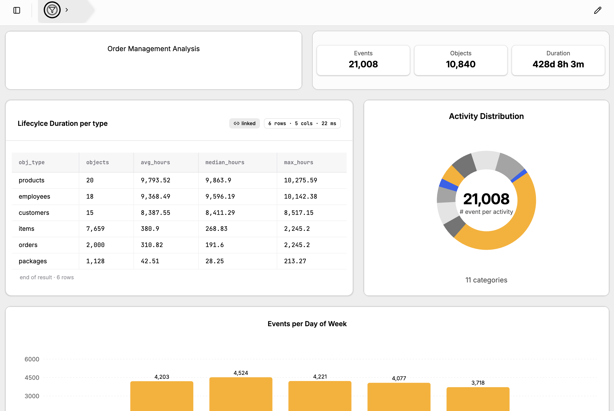
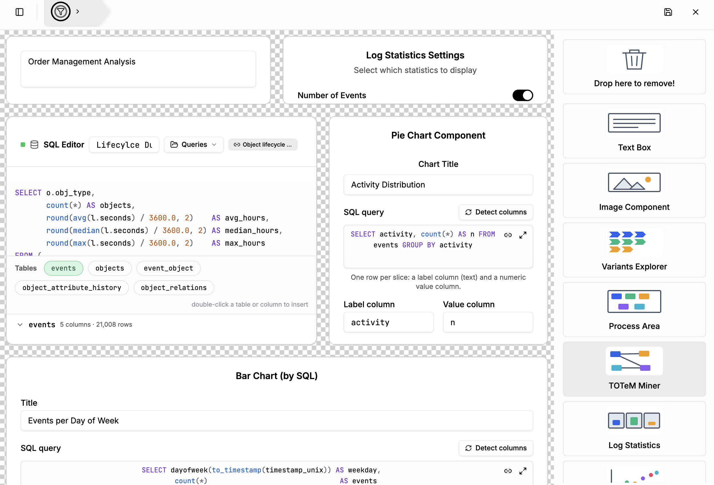

# Dashboard Creation

[← Back to the README](../../README.md#-features)

**Dashboards** combine several components on one page, for example a title, key figures, a process
model, and a few charts. You can build customized overviews for a specific question or audience.
Dashboards belong to a project and are saved with it.

## Creating a dashboard

1. In the sidebar, open **Dashboards** and click **Add Dashboard**. Enter a name.
2. Open the dashboard and click the **pencil** icon in the top right corner to enter **edit mode**.
3. Drag components from the panel on the right onto the grid, then move and resize them.
4. Click the **save** icon to store the layout, and the **×** to leave edit mode. If you leave with
   unsaved changes, the tool asks whether to keep editing or discard them.

Dashboards can be renamed or deleted from the sidebar.

## Edit mode

In edit mode, every component shows its settings instead of its content, for example the title and
SQL query of a chart or the statistics a *Log Statistics* tile displays. Drop a component on
**Drop here to remove!** to delete it.

Available components include:

- **Text Box** and **Image Component** (images come from the [Project Asset Store](project-asset-store.md)),
- **Log Statistics** (number of events, objects, activities, time span, …),
- analysis components: **Process Area**, **TOTeM Miner**, **OCCN**, **OC Petri Net**, **OC-DFG**,
  **Variants Explorer**, **OC Dotted Chart**, **Handover of Work**, and **Resource Profiling**,
- SQL-based components: **SQL Editor**, **Pie Chart**, **Bar Chart**, **Scatter Plot**, and **KPI**.

SQL-based components can **link** a stored query from the [Project Asset Store](project-asset-store.md).
When you edit that query, every linked component updates.

## View mode

In view mode, the layout is locked and all components show their results. The global filter in the
header applies to the whole dashboard, and every component can opt out of it with its own filter
toggle.
