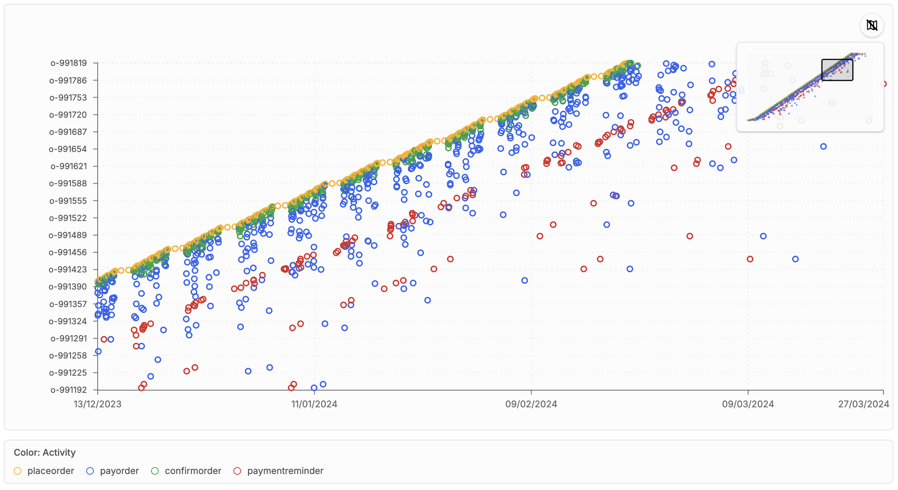

# Object-Centric Dotted Chart Analysis

[← Back to the README](../../README.md#-features)

The **Object-Centric Dotted Chart** draws every event as a dot. Unlike a classical dotted chart,
it does not assume a single case notion. You decide which dimension of the object-centric log is
used for the x-axis, the y-axis (the rows), the color, and the shape of the dots. This makes it
easy to spot batching, waiting times, seasonal patterns, and outliers.

## Where to find it

- **Analysis → OC Dotted Chart**
- **Dashboards**: add the *OC Dotted Chart* widget.

## Configuration

Click **Configure** to set:

- **X Axis** and **Y Axis**: for example time, activity, object instances of a type, qualifiers,
  or event and object attributes. By default, the x-axis is time and the y-axis is activity.
- **Object Type**: the object type used for object-based rows.
- **Color By** and **Shape By**: the dimensions that color and shape the dots.
- **Y Axis Order**: order the rows by first or last occurrence.
- **Max Points**: the number of events that are sampled for large logs.

Changes are applied when you click **Confirm**.

## Navigating the chart

- Drag a rectangle in the plot, or use the zoom sliders, to zoom into a time range or a set of
  rows. **Reset** returns to the full range.
- The **minimap** in the top right corner shows where you are in the complete chart and can be
  dragged. It can be hidden.
- The legend below the chart explains the colors.
- **Resample** draws a new sample of events when the log is larger than the point budget.
