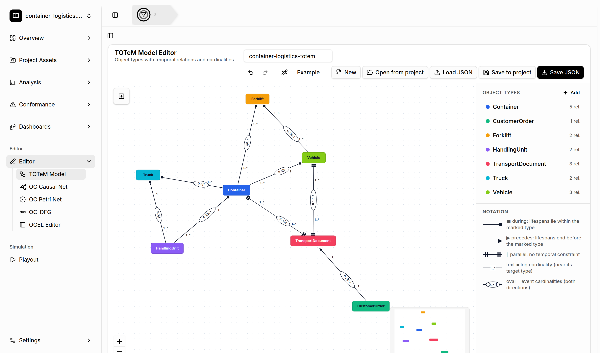

# Editors

[← Back to the README](../../README.md#-features)

The TOTeM Tool includes visual **editors** for all supported process model types and for the event
log itself. Use them to fix a discovered model, build a reference model by hand, or create a small
example for teaching or testing.

## Where to find them

Open **Editor** in the sidebar:

- **TOTeM Model**: object types with temporal relations and log and event cardinalities.
- **OC Causal Net**: activities, typed dependency arcs, and input and output binding groups.
- **OC Petri Net**: typed places, transitions (including silent transitions), and variable arcs.
- **OC-DFG**: activities, typed directly-follows arcs, and start and end nodes.
- **OCEL Editor**: a table-based editor for the events, objects, and relations of an event log.

The *Edit* action in **Project Assets → Model Assets** opens a stored model in the matching editor.

## Model editors

All four model editors share the same layout and toolbar:

- **Canvas**: add nodes with the floating toolbar on the left, and draw arcs by dragging between
  node handles. Select an element to edit its properties in the panel on the right. Press
  <kbd>Delete</kbd> or <kbd>Backspace</kbd> to remove the selection.
- **Right panel**: the object types of the model and a notation legend.
- **Toolbar**: undo and redo, **auto layout**, **Example** (loads an example model), **New**,
  **Open from project**, **Load JSON**, **Save to project**, and **Save JSON**.

**Open from project** and **Save to project** connect the editors to the
[Project Asset Store](project-asset-store.md). An edited model can then be used for
[conformance checking](totem-conformance.md) or [playout](playout.md). Models are stored as JSON;
the formats are documented in [MODEL_EDITORS.md](../MODEL_EDITORS.md).

## OCEL Editor

The OCEL Editor works on a copy of an event log. You can start from an empty log, upload an OCEL
file, or edit the log of the current project. The **Events**, **Objects**, and **Relations** tabs
show the log as paged, sortable tables. You can download the result (DuckDB, OCEL 2.0 SQLite, JSON,
or XML), export a table as LaTeX, or **Save as project** to analyze the edited log. See
[OCEL_EDITOR.md](../OCEL_EDITOR.md) for details.
