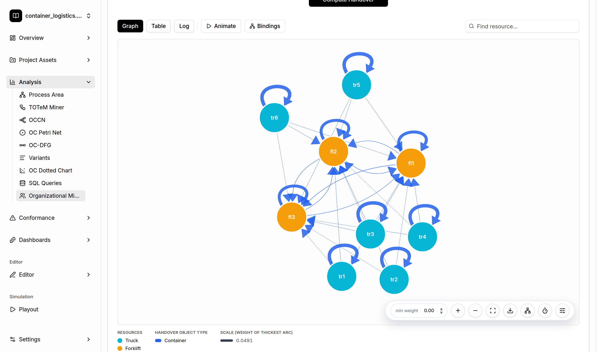
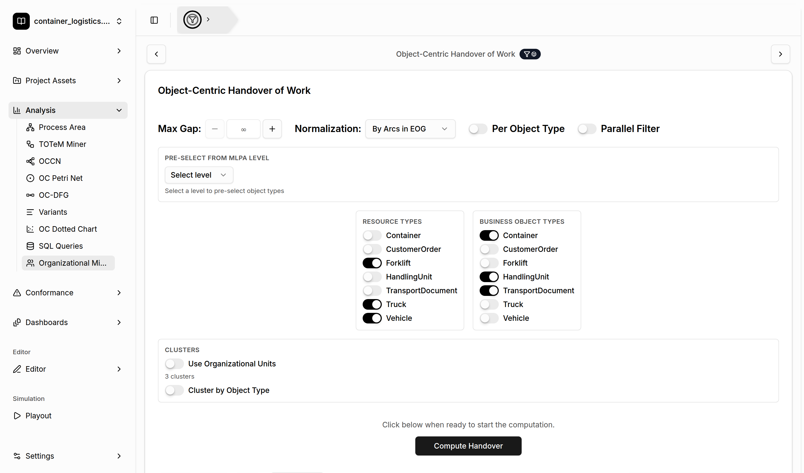

# Object-Centric Handover of Work Analysis

[← Back to the README](../../README.md#-features)

The **Object-Centric Handover of Work** analysis shows *who passes work to whom*. Resources (for
example trucks and forklifts) are the nodes. An arc from resource *A* to resource *B* means that a
business object (for example a container) was handled by *A* and then handed over to *B*. Arc
colors show the type of the handed-over object, and arc widths show how often the handover happens.

## Where to find it

- **Analysis → Organizational Mining**, then use the arrows at the top of the page to switch to
  *Object-Centric Handover of Work*.
- **Dashboards**: add the *Handover of Work* widget.

## Settings

- **Resource types** and **Business object types**: which object types act as resources and which
  are the objects that are handed over. **Pre-select from MLPA level** fills both lists based on
  the discovered [process area](process-area-discovery.md) levels.
- **Max Gap**: the maximum number of events allowed between two consecutive events of the same
  object for them to count as a handover. Leave it empty for no limit.
- **Normalization**: how arc weights are scaled (raw counts, relative to the total handovers per
  resource, or relative to the maximum weight). **Per Object Type** normalizes each object type
  separately.
- **Parallel Filter**: removes direct handovers between resources that work in parallel rather
  than in sequence.
- **Clusters**: **Use Organizational Units** collapses resources into the clusters found by
  [Resource Profiling](resource-profiling.md), so you see the handover between organizational
  units instead of individual resources. **Cluster by Object Type** groups the resources by type.

Click **Compute Handover** to run the analysis.

## Exploring the result

- **Graph**, **Table**, and **Log** show the handovers as a network, as a table, or as the
  underlying events.
- **Animate** replays the flow of objects between the resources over time. **Bindings** shows
  the input and output binding patterns of each resource, that is, which handovers happen together.
- **Find resource…** highlights a resource. **min weight** hides weak handovers.
- Hover over an arc to see how often the handover occurs and how long it takes on average.
