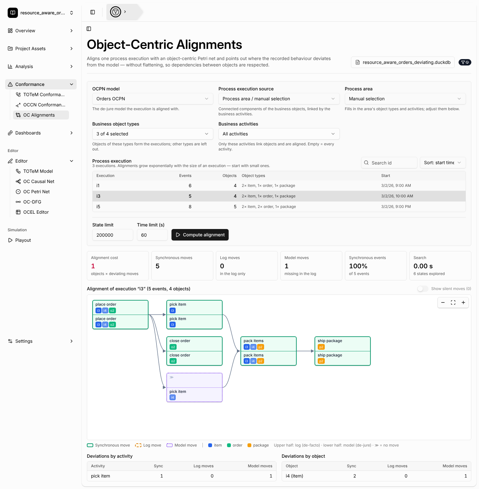

# Object-Centric Alignments

[← Back to the README](../../README.md#-features)

**Object-centric alignments** compare one process execution with an
[object-centric Petri net](oc-petri-net-discovery.md) and point out exactly where the recorded
behaviour deviates from the model. The execution is not flattened. Every move involves all of its
objects at once, so dependencies between objects are respected: an order and its items, or a
package and the order it ships. The method follows L. Liß, *Object-Centric Alignments*
(Master's thesis, RWTH Aachen, 2023).

## Where to find it

- **Conformance → OC Alignments**
- **Project Assets → Model Assets**: the *Use for conformance* action on an OCPN model opens this
  view with the model preselected.
- **Dashboards**: the *Object-Centric Alignment* component (see below).

## How to use it

1. Select a stored **OCPN model** from the [Project Asset Store](project-asset-store.md). Save one
   from **Analysis → OC Petri Net**, draw one in the OCPN editor, or upload it.
2. Choose where the **process execution** comes from:
   - **Process area / manual selection**: pick a process area (it fills in its object types and
     activities) or select **business object types** and **business activities** by hand. Business
     objects that share an event of a business activity belong to the same execution (connected
     components). Only the selected activities and object types are part of the execution.
     Resources such as workers therefore never merge executions.
   - **Stored process executions**: the execution ids written into the log by the
     [Variants Explorer](variant-discovery.md) (*Settings → Store in event log*). Every event
     with the same id belongs to the execution, with all of its objects.
3. Pick the **execution** in the table. It shows the number of events and objects per type. A ⚠
   marks executions with object types that the model does not contain.
4. Click **Compute alignment**.

Object types of the execution that the model does not contain are **ignored automatically**. Their
objects are removed before aligning, because a model move must use the same objects as the log. The
result names the ignored types and how many objects and events were left out.

## Reading the result

- **Alignment cost**: every log move and every visible model move costs one per object it
  involves. Synchronous moves are free. A cost of 0 means the execution fits the model.
- The **alignment graph** reads from left to right. Each box is one move: the upper half is the log
  (de-facto) part, the lower half is the model (de-jure) part, and ≫ means "no move".
  - **Synchronous move** (solid green): the event happened as the model allows.
  - **Log move** (dashed amber): the event happened, but the model does not allow it here.
  - **Model move** (dotted violet): the model requires this step, but the log does not record it.
  - Two moves are connected when they share an object. Object colours follow the object type, and
    objects of the same type get different shades. Silent (τ) model moves are hidden unless
    *Show silent moves* is on.
- **Deviations by activity / by object** count the log and model moves per activity and per
  object.

## Limits

Computing optimal alignments takes time that grows exponentially with the size of the execution
(objects × events) and with the cost of the alignment. Start with small executions.
- **State limit / time limit** bound the search. If the optimal search reaches a limit, a faster
  best-first search runs instead. Its alignment is valid but marked **approximate**: the shown
  cost is an upper bound, and the lower bound of the optimum is given next to it.
- When a variable arc would bind very many objects (more than about 12 at once), model moves only
  try single objects, all objects together, and the groups recorded in the log. A result whose
  optimality is not guaranteed is again marked approximate.
- If the model cannot reach its final marking with the objects of the execution (for example an
  order without items when the model requires items), there is **no alignment**, and the view says
  so.

## Dashboard component

The **Object-Centric Alignment** dashboard component stores a preselected model, execution source
and execution. In edit mode you can also choose whether viewers see the settings panel and whether
the alignment is computed when the dashboard opens. Changes viewers make in view mode are not
saved.
