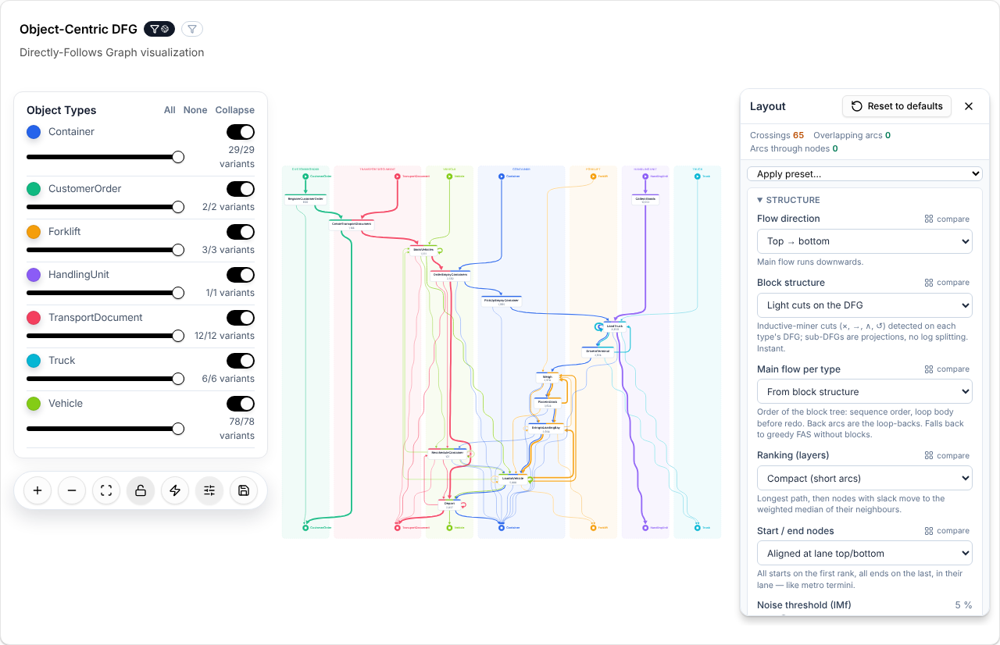

# Object-Centric Directly-Follows Graph Discovery

[← Back to the README](../../README.md#-features)

An **Object-Centric Directly-Follows Graph (OC-DFG)** overlays one directly-follows graph per
object type. An arc from activity *A* to activity *B* in the color of an object type means that
objects of this type are often handled by *B* directly after *A*. It is the most intuitive
object-centric process map and a good starting point for exploring a log.

## Where to find it

- **Analysis → OC-DFG**
- **Dashboards**: add the *Object-Centric DFG (Arc Weight)* or *Object-Centric DFG (Variants)* widget.
- A small OC-DFG of a single process area is also shown when you expand an area in the
  [Process Area Visualizer](process-area-discovery.md).

## Controls

- **Object Types panel**: a switch per object type shows or hides it, and a slider per type
  sets how many of the most frequent variants of that type are included (in the *Arc Weight*
  widget: the minimum arc weight). Reduce this number to focus on the main behavior. The panel
  can be collapsed and moved.
- **Toolbar**: zoom, fit to view, lock/unlock interactions, animate edges, **change the layout**
  (sliders icon, see below), and **save to assets**.
- Hover over nodes and arcs to see their frequencies. Hovering a node also fades every activity
  that is not directly connected to it; hovering a lane's title (or an object type in the panel)
  highlights only the arcs of that object type.

## Layout

The graph is drawn with a layout made for object-centric DFGs: every object type gets its own
lane in which its main flow runs from start to end (top to bottom by default), activities shared
by several object types sit between their lanes, and loops leave the flow to the side and run
back up in a channel next to the lane.

The **layout button** in the toolbar opens the layout panel next to the graph. Every change is
applied immediately and **stored**: with the dashboard widget for dashboards, with the project for
*Analysis → OC-DFG* and the overview page (which share their layout). **Reset to defaults**
removes the stored layout. *Apply preset…* loads a hand-picked combination (*Lanes & blocks*,
*Metro map*, *Engineering*, *Classic Sugiyama*, *Minimal ink*, *Left to right*), and **compare**
next to an option shows all its variants side by side — optionally as a matrix with a second
option; zooming into one cell zooms all cells to the same region. The panel also counts arc
crossings, arcs lying on top of each other and arcs running through nodes for the current layout.

The OC-DFGs inside the [Process Area Visualizer](process-area-discovery.md) use the default
layout from left to right.

### How the layout works

1. **Main flow per object type.** Every object type gets an order of its activities, from its
   start to its end. Arcs that point forward in that order are the main flow, arcs that point
   backwards are loops. The order can come from the block structure (below) or from a weighted
   feedback arc set, a depth-first search, SpringRank (least squares) or the distance from the
   start.
2. **Block structure.** Like the inductive miner, the layout looks for exclusive choices (×),
   sequences (→), parallel blocks (∧) and loops (↺) in each object type's DFG:
   - *Light cuts on the DFG* run the four cuts directly on the directly-follows graph and recurse
     on projected sub-graphs instead of split logs. A noise threshold ignores light arcs (as IMf
     does). This is instant.
   - *Inductive miner (log)* runs the real inductive miner of TOTeM on every object type's
     flattened log, splitting the log after every cut (`GET /api/ocdfg-block-structure/`).
   Parallel branches are placed next to each other and the arcs between them ("interleavings")
   can be dimmed or hidden. The redo part of a loop breaks out of the flow to the side.
3. **Layers.** The forward arcs of all object types together decide the layer (rank) of every
   activity; conflicts between object types are resolved with a weighted feedback arc set.
4. **Lanes.** Every object type gets its own lane, the lanes are ordered by the chosen strategy,
   and activities shared by several object types sit between their lanes. Inside a layer, nodes
   are spread without overlaps with minimal displacement from where their lane wants them.
5. **Arcs.** Long arcs get reserved space in every layer they cross, so they never run through
   nodes. Loops leave the flow sideways and go back up in a channel next to the lane; nested
   loops get channels further out. When another node is in the way, the loop leaves through the
   bottom and enters through the top instead.

### What you can change

| Aspect | Variants |
| --- | --- |
| Flow direction | top → bottom, left → right, bottom → top, right → left |
| Block structure | light cuts on the DFG, inductive miner on the log, none |
| Main flow per type | from block structure, greedy feedback arc set, DFS, SpringRank, distance from start |
| Layers | compact (short arcs), longest path ASAP, longest path ALAP |
| Start / end nodes | aligned at the top/bottom of the lane, next to the first/last activity |
| Order of object types | min. arc span (≈ crossings), shared activities adjacent, longest flow in the middle, most frequent in the middle, hub type in the middle, by first appearance, by process areas, alphabetical, manual (arrows in the legend) |
| Cross-axis placement | strict lanes, lanes + barycentre, Sugiyama without lanes |
| Shared activities | centre of their lanes, dominant lane, median lane |
| Choice / parallel branches | main branch straight, symmetric, ignore blocks |
| Loops break out to | right, left, outer side, inner side |
| Arc routing | flow curves, orthogonal, subway (45°), polyline, spline, straight lines |
| Loop-back arcs | side channel, side curve, through the layers |
| Where arcs attach | top/bottom plus loops on the sides, top in/bottom out only, nearest side, shortest path to the centre |
| Ports on a side | distributed, one port per object type, one port per side |
| Merge points | arcs of a type join shortly before/after a node |
| Arcs of several types between the same activities | highway (tight band), separate, fanned, merged (striped) |
| Self loops | loop on the side (default), ring at a corner, badge, hidden |
| Arcs inside parallel blocks | dimmed, normal, hidden |
| Arc width | square root, logarithmic, linear, quantile, constant; relative to the own object type or to all arcs; min/max width |
| Arrow head | triangle, stealth, open chevron, dot, chevrons along the arc, tapered arc, none |
| Activity style | box with type stripe, metro station, type gradient, pill, label only |
| Start / end style | circle, pill with name, terminus bar, small dot |

Spacing (layer gap, node gap, lane gap, track gap), corner radius, arrow size, opacity, white halos
under arcs, frequency labels and the lane/layer overlays are sliders and switches. Below
*Order of object types* the lanes are listed left to right; their arrows reorder them by hand.

Saved OC-DFGs end up in the [Project Asset Store](project-asset-store.md) and can be edited in the
[OC-DFG editor](editors.md).
