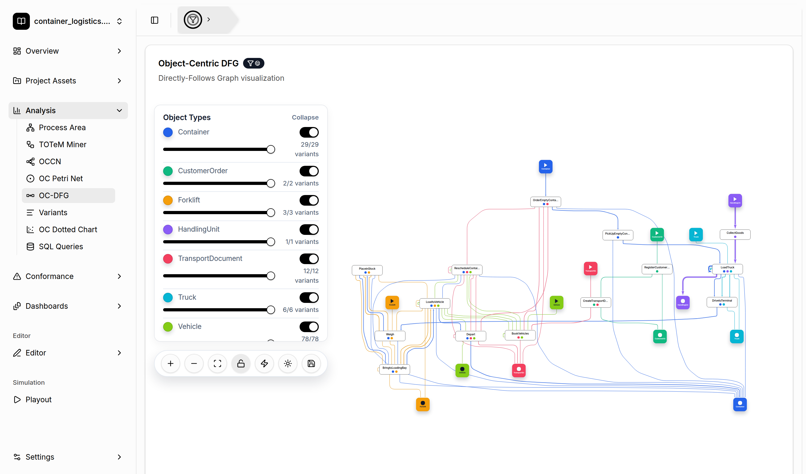

# Object-Centric Directly-Follows Graph Discovery

[← Back to the README](../../README.md#-features)

An **Object-Centric Directly-Follows Graph (OC-DFG)** overlays one directly-follows graph per
object type. An arc from activity *A* to activity *B* in the color of an object type means that
objects of this type are often handled by *B* directly after *A*. It is the most intuitive
object-centric process map and a good starting point for exploring a log.

## Where to find it

- **Analysis → OC-DFG**
- **Dashboards**: add the *Object-Centric DFG (Arc Weight)* or *Object-Centric DFG (Variants)* widget.
- A small OC-DFG of a single process area is also shown when you expand an area in the
  [Process Area Visualizer](process-area-discovery.md).

## Controls

- **Object Types panel**: a switch per object type shows or hides it, and a slider per type
  sets how many of the most frequent variants of that type are included. Reduce this number to
  focus on the main behavior. The panel can be collapsed and moved.
- **Toolbar**: zoom, fit to view, lock/unlock interactions, animate edges, dim the edges that
  touch start and end nodes, and **save to assets**.
- Hover over nodes and arcs to see their frequencies.

Saved OC-DFGs end up in the [Project Asset Store](project-asset-store.md) and can be edited in the
[OC-DFG editor](editors.md).
