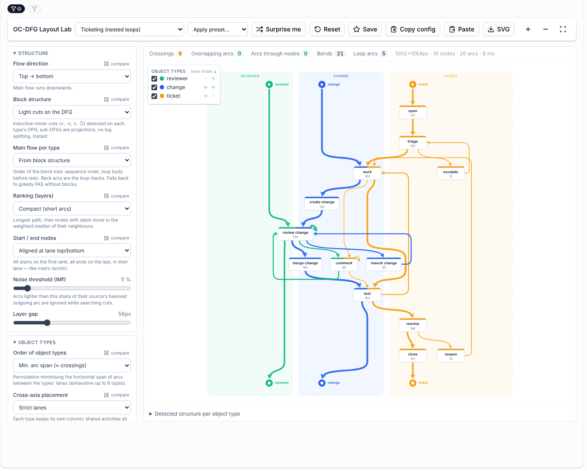

# OC-DFG Layout Lab

[← Back to the README](../../README.md#-features)

The **OC-DFG Layout Lab** is a workbench for finding a good way to draw object-centric
directly-follows graphs. It lays out the [OC-DFG](oc-dfg-discovery.md) of the selected event
log — or of one of the built-in examples — with a configurable layout algorithm. Every aspect of
the layout and of the drawing can be swapped independently, and any aspect can be compared side by
side, alone or crossed with a second aspect.

## Where to find it

**Analysis → OC-DFG Layout Lab.** Without a selected event log the lab starts with a built-in
example (order to cash, a loan application with parallel checks, ticketing with nested loops,
procurement with seven object types, and a tiny one). The global and local filters work as in
every other analysis view.

## How the layout works

1. **Main flow per object type.** Every object type gets an order of its activities, from its
   start to its end. Arcs that point forward in that order are the main flow, arcs that point
   backwards are loops. The order can come from the block structure (below) or from a weighted
   feedback arc set, a depth-first search, SpringRank (least squares) or the distance from the
   start.
2. **Block structure.** Like the inductive miner, the lab looks for exclusive choices (×),
   sequences (→), parallel blocks (∧) and loops (↺) in each object type's DFG:
   - *Light cuts on the DFG* run the four cuts directly on the directly-follows graph and recurse
     on projected sub-graphs instead of split logs. A noise threshold ignores light arcs (as IMf
     does). This is instant.
   - *Inductive miner (log)* runs the real inductive miner of TOTeM on every object type's
     flattened log, splitting the log after every cut (`GET /api/ocdfg-block-structure/`).
   Parallel branches are placed next to each other and the arcs between them ("interleavings")
   can be dimmed or hidden. The redo part of a loop breaks out of the flow to the side.
   **Detected structure per object type** below the drawing shows the block tree of every type.
3. **Layers.** The forward arcs of all object types together decide the layer (rank) of every
   activity; conflicts between object types are resolved with a weighted feedback arc set.
4. **Lanes.** Every object type gets its own lane, the lanes are ordered by the chosen strategy,
   and activities shared by several object types sit between their lanes. Inside a layer, nodes
   are spread without overlaps with minimal displacement from where their lane wants them.
5. **Arcs.** Long arcs get reserved space in every layer they cross, so they never run through
   nodes. Loops leave the flow sideways and go back up in a channel next to the lane; nested
   loops get channels further out. When another node is in the way, the loop leaves through the
   bottom and enters through the top instead.

## What you can vary

| Aspect | Variants |
| --- | --- |
| Flow direction | top → bottom, left → right, bottom → top, right → left |
| Block structure | light cuts on the DFG, inductive miner on the log, none |
| Main flow per type | from block structure, greedy feedback arc set, DFS, SpringRank, distance from start |
| Layers | compact (short arcs), longest path ASAP, longest path ALAP |
| Start / end nodes | aligned at the top/bottom of the lane, next to the first/last activity |
| Order of object types | min. arc span (≈ crossings), shared activities adjacent, longest flow in the middle, most frequent in the middle, hub type in the middle, by first appearance, by process areas, alphabetical, manual (arrows in the legend) |
| Cross-axis placement | strict lanes, lanes + barycentre, Sugiyama without lanes |
| Shared activities | centre of their lanes, dominant lane, median lane |
| Choice / parallel branches | main branch straight, symmetric, ignore blocks |
| Loops break out to | right, left, outer side, inner side |
| Arc routing | flow curves, orthogonal, subway (45°), polyline, spline, straight lines |
| Loop-back arcs | side channel, side curve, through the layers |
| Where arcs attach | top/bottom plus loops on the sides, top in/bottom out only, nearest side, shortest path to the centre |
| Ports on a side | distributed, one port per object type, one port per side |
| Merge points | arcs of a type join shortly before/after a node |
| Arcs of several types between the same activities | highway (tight band), separate, fanned, merged (striped) |
| Self loops | ring at a corner, loop on the side, badge, hidden |
| Arcs inside parallel blocks | dimmed, normal, hidden |
| Arc width | square root, logarithmic, linear, quantile, constant; relative to the own object type or to all arcs; min/max width |
| Arrow head | triangle, stealth, open chevron, dot, chevrons along the arc, tapered arc, none |
| Activity style | box with type stripe, metro station, type gradient, pill, label only |
| Start / end style | circle, pill with name, terminus bar, small dot |

Spacing (layer gap, node gap, lane gap, track gap), corner radius, arrow size, opacity, white halos
under arcs, frequency labels and the lane/layer overlays are sliders and switches.

## Exploring

- **compare** next to an aspect opens all its variants side by side. Pick a second aspect to get
  a matrix (for example *Arc routing* × *Arcs of several types*). Zooming into one cell zooms all
  cells to the same region, which makes small differences such as self-loop styles easy to see.
  **Use this** adopts a variant.
- **Apply preset…** loads a hand-picked combination (*Lanes & blocks*, *Metro map*,
  *Engineering*, *Classic Sugiyama*, *Minimal ink*, *Left to right*). **Surprise me** picks a
  random combination.
- **Save** keeps the current combination in the favourites list, **Copy config** copies the
  options that differ from the defaults as JSON, **Paste** applies such a JSON, and **SVG**
  downloads the drawing.
- The metrics bar counts arc **crossings**, **overlapping arcs** (lines on top of each other),
  **arcs through nodes**, bends and loop arcs for the current layout; in the comparison the
  variant with the fewest problems is outlined in green.
- Hovering an object type in the legend highlights its arcs, hovering a node highlights its arcs.
  The legend's checkboxes hide object types, its arrows reorder the lanes by hand.
- **Min. arc frequency** hides arcs lighter than a share of their object type's heaviest arc and
  **Variant coverage** keeps only the arcs of the most frequent variants. Use them (or hide
  object types) for dense logs; the lab stops laying out above 4000 arcs.

The selected options are remembered in the browser.
