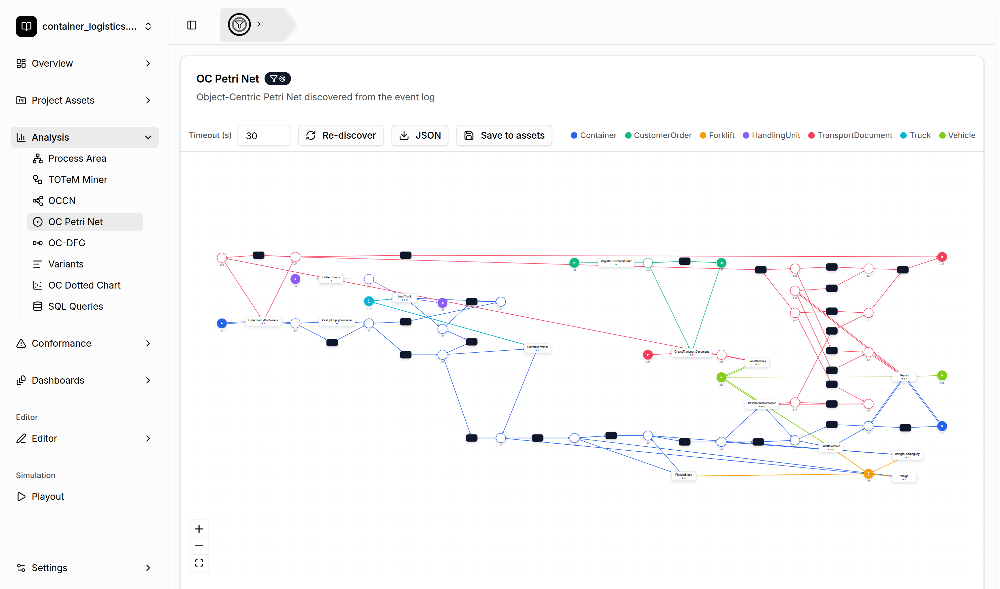

# Object-Centric Petri Net Discovery

[← Back to the README](../../README.md#-features)

An **Object-Centric Petri Net (OCPN)** is the object-centric extension of classical Petri nets.
Places are typed by object type, and transitions can consume and produce tokens of several
object types at once. Double (variable) arcs indicate that a transition can handle a whole set
of objects of a type at the same time.

## Where to find it

- **Analysis → OC Petri Net**: discovery starts automatically when you open the view.
- **Dashboards**: add the *OC Petri Net* widget.

## How it works

The tool discovers one Petri net per object type with the inductive miner and then merges these
nets into one object-centric Petri net. Places and arcs are colored by object type (see the legend
above the canvas). Filled black rectangles are silent (τ) transitions.

## Controls

- **Timeout (s)**: the maximum time the discovery may take. Large logs can need a higher value.
- **Discover / Re-discover**: runs the discovery again, for example after you change the global filter.
- **JSON**: downloads the discovered net as a JSON file.
- **Save to assets**: stores the net in the [Project Asset Store](project-asset-store.md) so you
  can open it in the [OC Petri Net editor](editors.md) or use it for [playout](playout.md).
