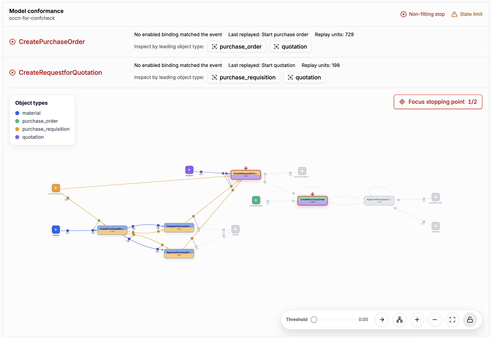

# OCCN Conformance

[← Back to the README](../../README.md#-features)

**OCCN conformance checking** replays an event log on an
[Object-Centric Causal Net](occn-discovery.md). The log is split into **replay units** (groups of
related events and objects), and every unit is replayed against the binding semantics of the net.
The result tells you how much of the log fits the model and exactly where the replay gets stuck.

## Where to find it

- **Conformance → OCCN Conformance**
- **Project Assets → Model Assets**: the *Use for conformance* action on an OCCN model opens this
  view with the model preselected.

## How to use it

1. Select a stored **OCCN model** from the [Project Asset Store](project-asset-store.md).
2. Choose the **replay unit strategy**:
   - *Standard*: connected components of related objects,
   - *Leading object type*: one unit per object of a chosen type,
   - *Stored process executions*: the executions stored in the log by the
     [Variants Explorer](variant-discovery.md).
3. Optionally ignore object types that are not part of the model, and set a **state limit** per
   replay unit to bound the search.
4. Click **Run conformance**.

## Reading the result

- The summary shows the **fitness**, the **coverage**, and the number of fitting, non-fitting, and
  inconclusive replay units.
- **Model conformance** lists the activities where replay units stopped, with the reason (for
  example "No enabled binding matched the event"), the last replayed activity, and the number of
  affected units. Use **Inspect by leading object type** to drill down.
- The model view marks the **stopping points** with red arrows. **Focus stopping point** jumps from
  one to the next.
- The **Replay units** table and the **replay unit detail** show, for every unit, whether it fits,
  where it failed, and the sequence of its events.
