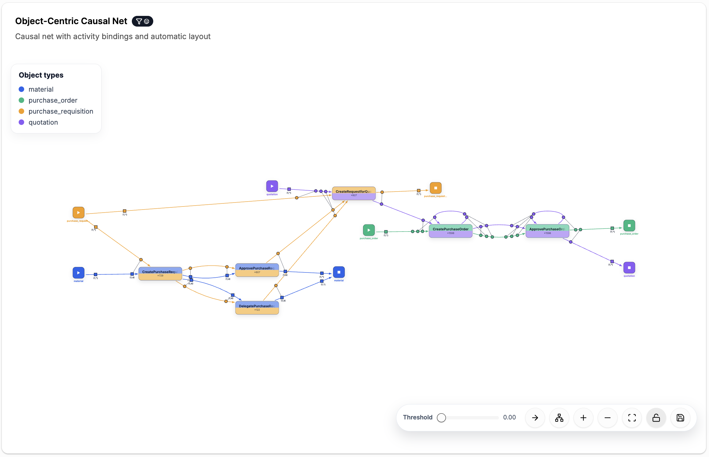

# Object-Centric Causal Net (OCCN) Discovery

[← Back to the README](../../README.md#-features)

An **Object-Centric Causal Net (OCCN)** describes the control flow of an object-centric process.
Activities are connected by dependency arcs. For every object type, *binding markers* on the arcs
specify which objects an activity consumes and produces, and in which combinations. OCCNs can
express precisely how many objects of each type are involved when activities synchronize.

## Where to find it

- **Overview**: the second card on the overview page.
- **Analysis → OCCN**
- **Dashboards**: add the *Object-Centric Causal Net (OCCN)* widget.

## How to read the model

- **Colored start and end nodes** mark where the objects of each type begin and end their lifecycle.
- **Activity nodes** show the activity name and how often it occurs. The colors show the object
  types that take part in the activity.
- **Markers** on the arcs are the input and output bindings. Markers that are connected form one
  group that fires together (AND); separate groups are alternatives (XOR). Square markers carry a
  cardinality such as `(1,*)`.
- The **Object types** legend at the top left maps colors to object types.

## Controls

The toolbar at the bottom right offers:

- **Threshold**: the relative occurrence threshold. Increase it to hide infrequent behavior;
  the net is rediscovered when you release the slider.
- **Layout direction** (left-to-right or top-to-bottom) and **re-run automatic layout**.
- **Zoom**, **fit to view**, and **lock/unlock** interactions.
- **Save to assets**: stores the discovered net in the [Project Asset Store](project-asset-store.md)
  for [OCCN conformance checking](occn-conformance.md), the [OCCN editor](editors.md), or
  [playout](playout.md).
