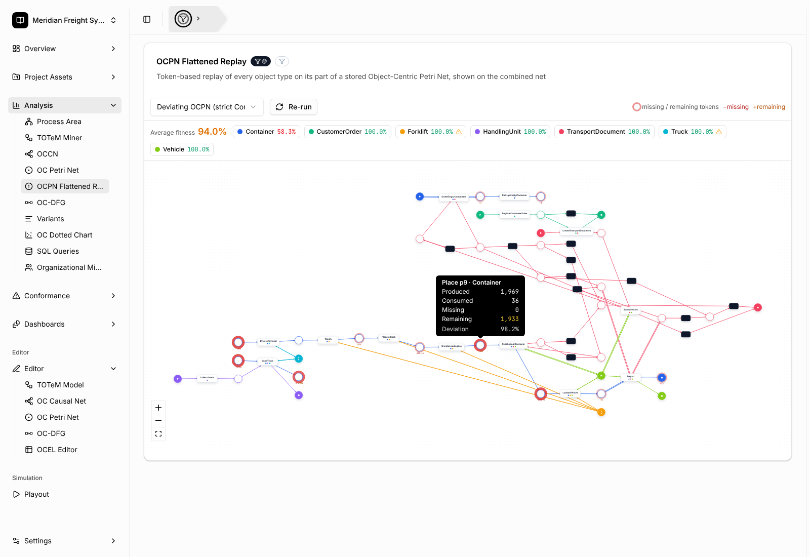

# OCPN Flattened Replay

**OCPN flattened replay** checks how well an event log fits a stored
**Object-Centric Petri Net (OCPN)** by running classical *token-based replay*
once per object type. The results of all object types are shown together on
the combined object-centric net.

Open it under **Analysis → OCPN Flattened Replay**, or add the
**OCPN Flattened Replay** widget to a dashboard.

## Usage

1. Select an event log.
2. Pick a stored OCPN from the project's [Model Assets](project-asset-store.md).
   You can save one from [OC Petri Net discovery](oc-petri-net-discovery.md) or
   build one in the [OCPN editor](editors.md).
3. Click **Run**. The global filter and the local filter of the view are applied
   to the log before the replay.

## How the replay works

For every object type of the net:

* **Projection.** The replay only uses the places of that object type, the arcs
  attached to them and the transitions those arcs connect. Transitions that have
  no place of the type are ignored, and so are places and arcs of other types.
* **Flattening.** Each object is a case. Its trace is the sequence of activities
  of its events, ordered by timestamp (ties are broken by event id).
* **Start and end.** One token is produced in every start place. These are the
  places marked as initial or, if none are marked, the places without incoming
  arcs. At the end, one token is consumed from every end place, which is every
  place with no outgoing arc of that type. If every place has an outgoing arc,
  for example because the net is a cycle, the places marked as final are used
  instead.
* **Firing.** Each event fires the transition with the same label. It consumes
  one token from every input place and produces one token in every output place.
  A variable arc consumes or produces exactly one token, because each object is
  replayed on its own.
* **Silent transitions.** If an input place has no token, the replay first
  searches backward from that place through silent transitions. It then fires
  the shortest sequence of enabled silent transitions that puts a token there.
  The same search runs before the end places are consumed. The search is
  bounded: if it hits the bound, the tokens are counted as missing, and a
  warning is shown.
* **Missing tokens.** Tokens that are still missing are created and counted as
  missing (*m*). Tokens left in the net at the end are counted as remaining
  (*r*).
* **Activities not in the net.** An event whose activity has no transition in
  the type's projection is skipped. The skipped event does not change the token
  counts, but it is reported for the object type, and the object is not counted
  as fitting.

**Fitness** of an object type, summed over all its objects:
`0.5 · (1 − m / c) + 0.5 · (1 − r / p)`. Here *p* is the number of produced
tokens and *c* the number of consumed tokens. The **average fitness** is the
unweighted mean over the object types that have at least one object.

Labels of non-silent transitions must be unique. If two visible transitions
share a label, the replay stops with an error that asks you to rename them.

## Reading the result

* The header shows the **average fitness**, plus one chip per object type with
  its fitness. Hover a chip to see the number of objects and variants, the
  number of fitting objects, the totals *p / c / m / r*, the skipped activities
  and any notes.
* Places with missing or remaining tokens are drawn with a **red halo**. The
  stronger the halo, the higher the place's deviation, which is
  `(missing + remaining) / (produced + missing)`. Small badges under a place
  show `−missing` and `+remaining`.
* **Hover a place** to see its produced, consumed, missing and remaining tokens.
* Object types that appear in the log but not in the model are listed and are
  not replayed.
