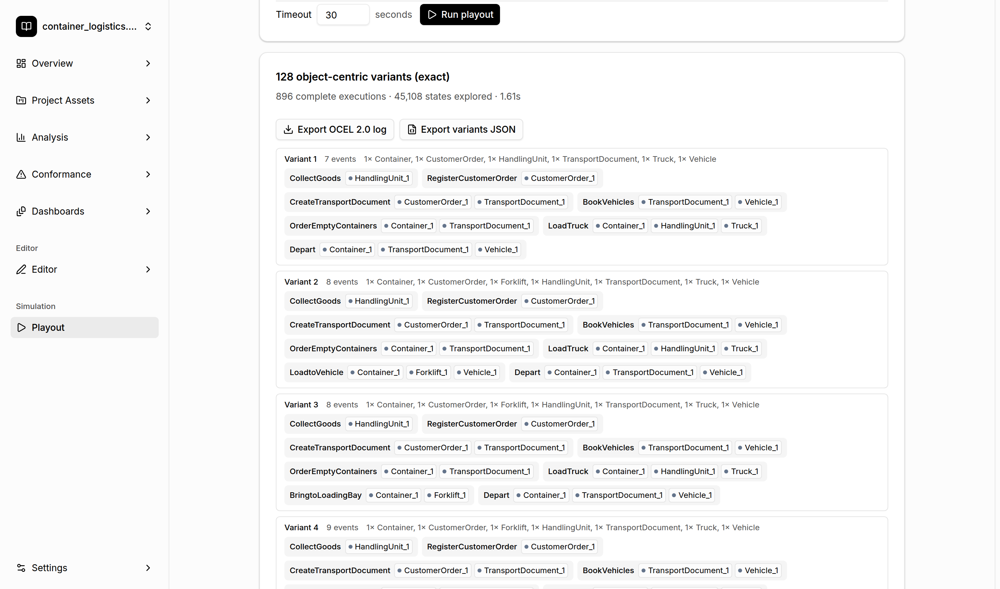

# Playout

[← Back to the README](../../README.md#-features)

**Playout** simulates an object-centric process model. Given an
[Object-Centric Petri Net](oc-petri-net-discovery.md) or an [Object-Centric Causal Net](occn-discovery.md),
it enumerates **all object-centric variants** the model allows within the limits you set, and it
can export them as a synthetic OCEL 2.0 event log. Use it to check what a model really allows,
to compare models, or to generate test data.

## Where to find it

**Simulation → Playout** in the sidebar.

## How to use it

1. **Choose a model**: a stored OCCN or OCPN from the [Project Asset Store](project-asset-store.md),
   the model currently open in the OC Petri Net or OC Causal Net [editor](editors.md), a JSON file,
   or one of the example models.
2. **Set the limits per process execution**:
   - **Objects per type**: how many objects of each type take part in one execution.
   - **Max occurrences per activity**: how often each activity may occur (the *All* − / + buttons
     change all of them at once).
   - **Timeout**: the maximum search time in seconds.
3. Click **Run playout**. A running search can be stopped at any time.

## Reading the result

The summary shows the number of distinct variants, the number of complete executions, the number of
explored states, and the run time. If the timeout or the state limit was reached, the count is shown
as "at least N". Each variant lists its events with the objects involved.

- **Export OCEL 2.0 log** downloads all variants as an event log that you can import into the TOTeM
  Tool or any other OCEL 2.0 tool.
- **Export variants JSON** downloads the variants in a compact JSON format.

For details on the semantics and the search, see [PLAYOUT.md](../PLAYOUT.md).
