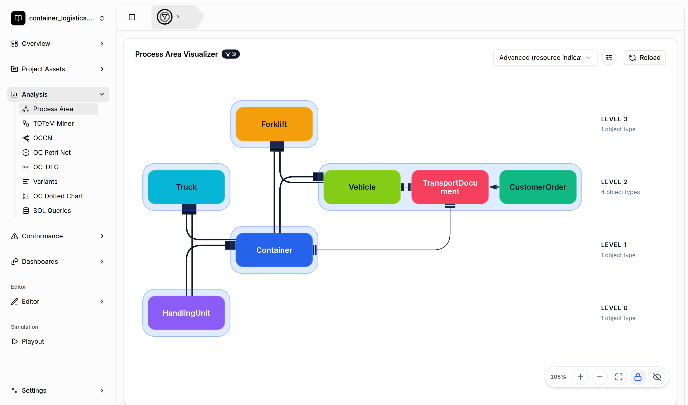
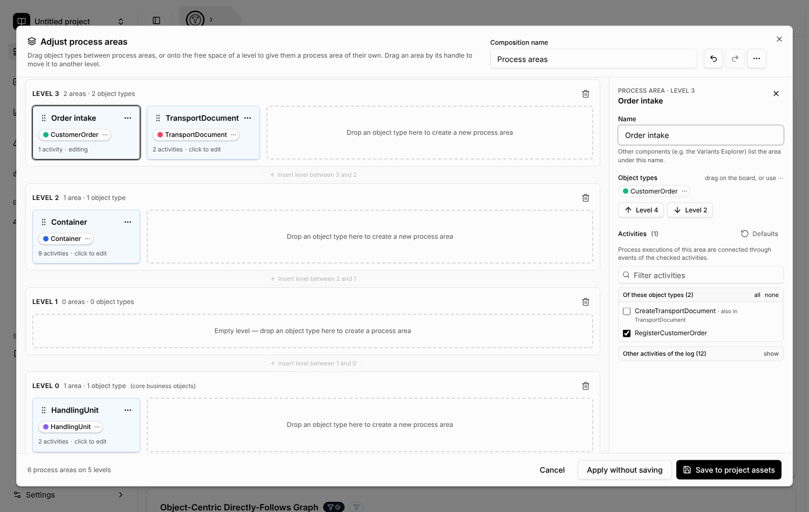

# Process Area Discovery

[← Back to the README](../../README.md#-features)

Real-world object-centric event logs quickly contain many object types. Process area discovery
groups these object types into **process areas** and arranges them on **levels**, so you can see
the structure of the whole process at a glance before you look at the details.

## Where to find it

- **Overview**: the Process Area Visualizer is the first card on the overview page.
- **Analysis → Process Area**: the same visualizer on its own page.
- **Dashboards**: add the *Process Area* widget to a dashboard.

## How it works

The tool offers two discovery algorithms. Pick one in the drop-down at the top right of the card:

| Algorithm | Idea |
|---|---|
| **MLPA (temporal)** | Discovers a TOTeM model and layers the object types by their temporal relations. |
| **Advanced (resource indicators)** *(default)* | Combines three *resource indicators* (temporal, cardinality, and divergence) and solves an optimization problem to assign object types to levels. |

In both modes, **higher levels hold the resources** (for example, forklifts or trucks) that serve
the object types on the levels below them. Object types on the same level that belong together
form a process area (the blue boxes).

## Working with the visualizer

- **Indicator weights**: in *Advanced* mode, the sliders button next to the algorithm selector opens
  the weights for the temporal, cardinality, and divergence indicators and the separation (α) and
  cohesion (β) parameters. **Reset to defaults** restores the defaults.
- **Reload** recomputes the process areas, for example after you change the global filter.
- **Details**: expand a process area to see an embedded object-centric directly-follows graph
  of its object types. By default (level-based view) it only contains the activities that belong
  to the area, i.e. not those already claimed by a lower process area (or, for an adjusted
  composition, the activities you chose for the area). The eye button switches to the detailed
  view, which shows every activity of the area's object types.
- **Filter by process area**: hover over an area and click the small filter icon to set the
  global object-type and activity filter to exactly that area. Every other analysis then works
  on this part of the process only.
- The areas shown in the visualizer are also used by the [Variant Explorer](variant-discovery.md)
  ("Connected components per process area", and "From a process area" in the custom extraction)
  and by the OC alignments.

## Adjusting process areas by hand

A discovery is a proposal. Click **Edit** in the header of the card to change the process areas
right on the canvas:

- **Move an object type to another process area**: drag its node onto the area.
- **Take an object type out of its process area**: drag it onto **+ New process area** next to a
  level. It becomes a separate process area on that level. Use this also to move an object type
  to another level. Dropping it on **Not in any process area** (top left) takes it out of every
  area.
- **Move a whole process area**: drag it by its handle (⠿, top left of the area) onto
  **+ New process area** of another level, or onto another area to merge the two.
- **Add and remove levels**: next to each level's name, **+↑** and **+↓** insert a level above or
  below it and the bin removes it (its object types move to *Not in any process area*). Empty
  levels are dropped when you finish editing.
- **Name and activities**: click an area to open its panel on the right. Name the area and check
  the activities that belong to it; activities of other object types of the log are listed under
  *Other activities*. **Defaults** restores the discovery's rule (every activity of the area's
  object types that no lower area claims). Moving object types updates the activities
  automatically. The panel's ⋯ menus offer every move without dragging.
- **Composition name**: in the header. Area names must be unique within a composition, so other
  parts of the tool can refer to an area by its name; the ⚠ badge lists what still needs fixing.
- **Undo / Redo** (Ctrl+Z / Ctrl+Shift+Z) work for every change; **Cancel** discards them.

**Done** shows the adjusted areas for this session without saving them. **Save** stores the
composition as a *Process Areas* asset of the project (*Save changes* / *Save as new* when you
edit a stored one).

## Stored process areas

- The drop-down at the top of the card switches between the **discovered areas** and every
  composition stored in the project. A dashboard widget remembers which one it shows.
- **Project Assets → Process Areas** lists the stored compositions with their areas. Open one in
  the Process Area view, rename, download (JSON) or delete it there.
- In the **Variant Explorer**, the *Process areas* selector of the "Connected components per
  process area" method runs the computation on a stored composition; the variant tabs are named
  after its areas. In the custom resource-aware extraction and in the **OC alignments**, the
  *Process area* picker lists the areas of every stored composition by name.
