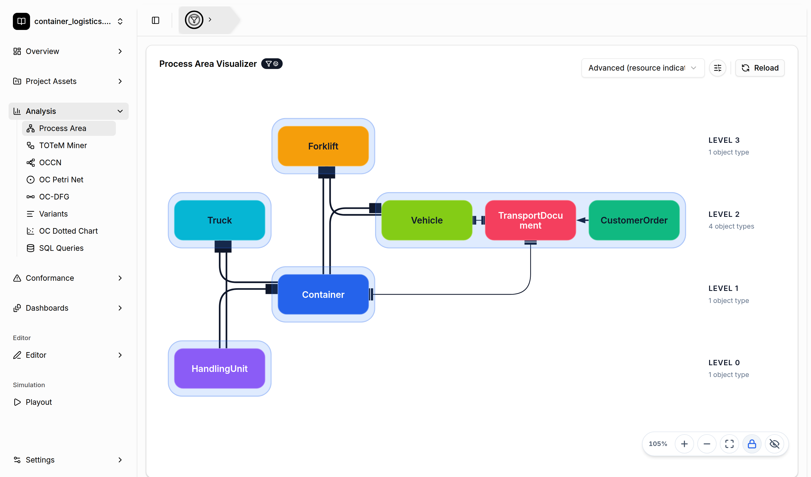

# Process Area Discovery

[← Back to the README](../../README.md#-features)

Real-world object-centric event logs quickly contain many object types. Process area discovery
groups these object types into **process areas** and arranges them on **levels**, so you can see
the structure of the whole process at a glance before you look at the details.

## Where to find it

- **Overview**: the Process Area Visualizer is the first card on the overview page.
- **Analysis → Process Area**: the same visualizer on its own page.
- **Dashboards**: add the *Process Area* widget to a dashboard.

## How it works

The tool offers two discovery algorithms. Pick one in the drop-down at the top right of the card:

| Algorithm | Idea |
|---|---|
| **MLPA (temporal)** | Discovers a TOTeM model and layers the object types by their temporal relations. |
| **Advanced (resource indicators)** *(default)* | Combines three *resource indicators* (temporal, cardinality, and divergence) and solves an optimization problem to assign object types to levels. |

In both modes, **higher levels hold the resources** (for example, forklifts or trucks) that serve
the object types on the levels below them. Object types on the same level that belong together
form a process area (the blue boxes).

## Working with the visualizer

- **Indicator weights**: in *Advanced* mode, the sliders button next to the algorithm selector opens
  the weights for the temporal, cardinality, and divergence indicators and the separation (α) and
  cohesion (β) parameters. **Reset to defaults** restores the defaults.
- **Reload** recomputes the process areas, for example after you change the global filter.
- **Details**: expand a process area to see an embedded object-centric directly-follows graph
  of the activities in that area. The eye button switches between the level-based view and a
  detailed view that shows all activities.
- **Filter by process area**: hover over an area and click the small filter icon to set the
  global object-type and activity filter to exactly that area. Every other analysis then works
  on this part of the process only.
- The discovered areas are also offered as a starting point in the
  [Variant Explorer](variant-discovery.md) ("From a process area").
