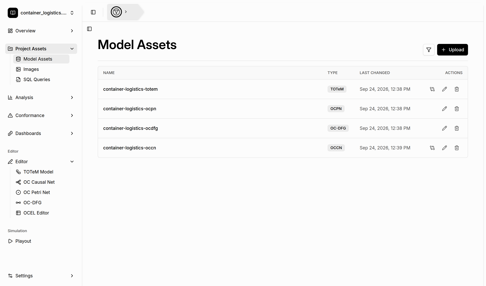
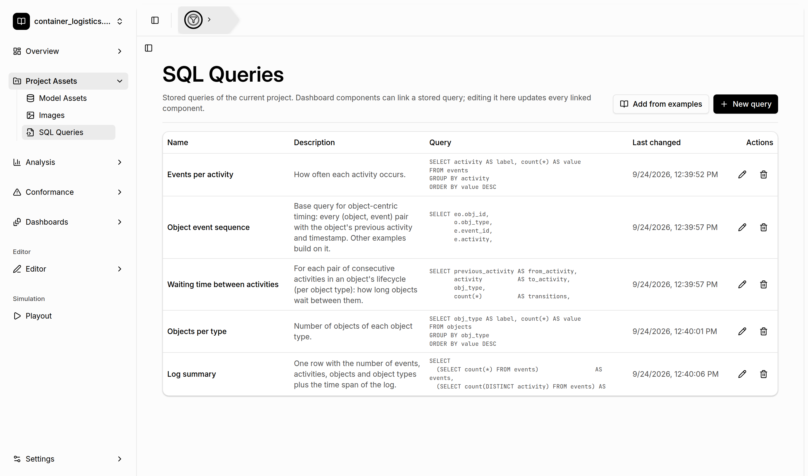

# Project Asset Store

[← Back to the README](../../README.md#-features)

Every event log you import becomes a **project**. Besides the event log, a project has an **asset
store**: a place where models, queries, and images are **persisted** and **shared between
components**. You create an asset in one part of the tool and pick it up in another. For example,
you discover a model, refine it in an editor, check it against the log, and simulate it with
playout. Each of these components reads from and writes to the same store.

## Asset types

| Asset | Page | Created by | Used by |
|---|---|---|---|
| **TOTeM model** | Model Assets | [TOTeM Miner](totem-discovery.md), [TOTeM editor](editors.md), upload | [TOTeM conformance](totem-conformance.md), TOTeM editor |
| **Object-Centric Causal Net (OCCN)** | Model Assets | [OCCN discovery](occn-discovery.md), [OCCN editor](editors.md), upload | [OCCN conformance](occn-conformance.md), OCCN editor, [Playout](playout.md) |
| **Object-Centric Petri Net (OCPN)** | Model Assets | [OC Petri Net discovery](oc-petri-net-discovery.md), [OCPN editor](editors.md), upload | OCPN editor, [Playout](playout.md) |
| **Object-Centric DFG (OC-DFG)** | Model Assets | [OC-DFG discovery](oc-dfg-discovery.md), [OC-DFG editor](editors.md), upload | OC-DFG editor |
| **SQL query** | SQL Queries | [SQL editor](sql-queries.md), example library, *New query* | SQL editor, other queries, [dashboard](dashboards.md) widgets |
| **Image** | Images | upload (PNG, JPEG, SVG) | the *Image* widget in [dashboards](dashboards.md) |

## Passing assets between components

- **Save to assets**: every discovery view has this button. The model is stored under a name you
  choose. If the global filter is active when you save, the filter is recorded with the model.
- **Open from project / Save to project**: the [editors](editors.md) load assets from the store and
  save changes back, either updating the asset or storing a new one.
- **Model selectors**: [conformance checking](totem-conformance.md) and [playout](playout.md) list the
  matching assets of the project.
- **Linked queries**: dashboard widgets link stored SQL queries. Editing the query in the store
  updates all linked widgets.

## Managing assets

Open **Project Assets** in the sidebar:

- **Model Assets** lists all stored models with their type and last change. You can filter by type
  and date and **upload** models as JSON files. The row actions open a model in its editor, use it
  for conformance checking (TOTeM and OCCN), or delete it.
- **SQL Queries** lists the stored queries. You can add new queries, add queries from the example
  library, and edit or delete queries.
- **Images** stores images for dashboards. You can upload, rename, and delete them.

Asset names are unique within a project. Models are validated and stored in a canonical JSON
format, so they can be exchanged with the TOTeM library and other tools. For the formats, see
[MODEL_ASSETS.md](../MODEL_ASSETS.md).
