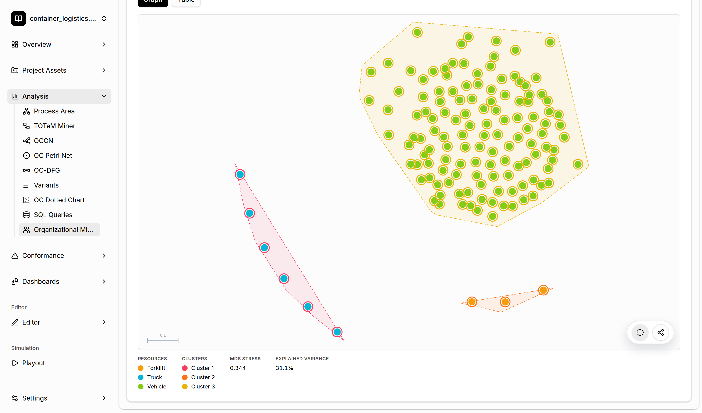

# Object-Centric Resource Profiling

[← Back to the README](../../README.md#-features)

**Resource Profiling** builds a feature profile for every resource: which activities it
performs, which other resources it works with, which business objects it handles, and when it
works. Resources with similar profiles are clustered into **organizational units**. A 2D map
(multidimensional scaling) shows how similar the resources are.

## Where to find it

- **Analysis → Organizational Mining**: Resource Profiling is the first page. Use the arrows at the
  top to switch to the [Handover of Work](handover-of-work.md) analysis.
- **Dashboards**: add the *Resource Profiling* widget.

## Settings

- **Resource types**: the object types whose objects are profiled (for example Truck, Forklift,
  and Vehicle).
- **Features**: the parts of the profile. Options are *activity fractions*, *co-occurrence*,
  *object collaboration*, *business object type fractions*, and *time binning* (hourly or weekly).
- **Tooltip extras**: additional feature groups shown when you hover over a resource.
- **Clustering**: turn clustering on or off and choose the method (*K-Means*, *Agglomerative*, or
  *HDBSCAN*), the minimum cluster size, and the distance measure (*Euclidean* or *Hellinger*).

Click **Compute Profile Matrix** to run the analysis.

## Exploring the result

- **Graph** shows the 2D map. Every dot is a resource colored by its type, and the shaded areas are
  the clusters. **MDS stress** and **explained variance** indicate how faithful the 2D map is.
- **Table** shows the full profile matrix.
- The clusters are shared with the [Handover of Work](handover-of-work.md) analysis, where you can
  use them as organizational units.
