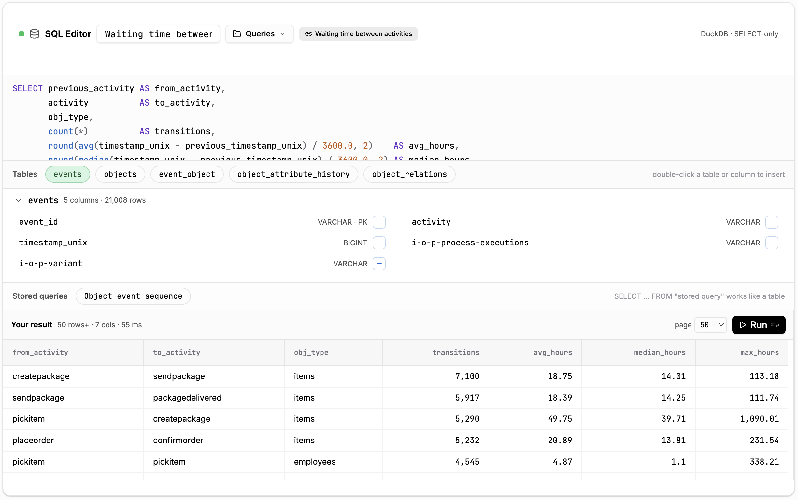
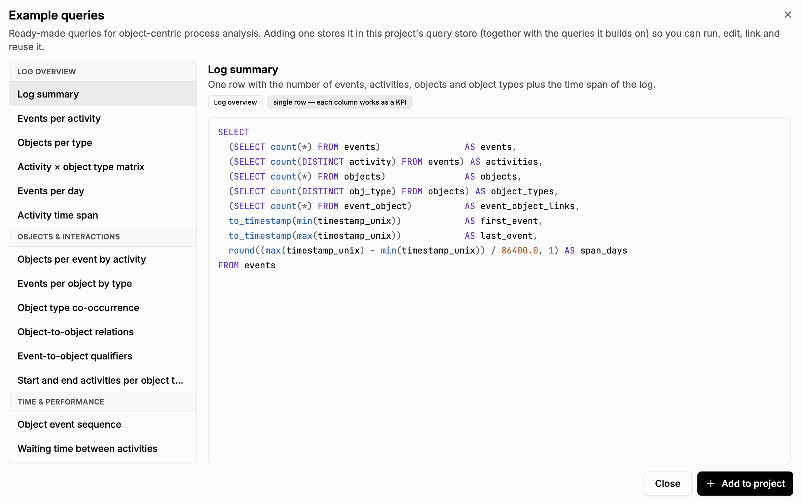

# SQL Queries

[← Back to the README](../../README.md#-features)

Every event log in the TOTeM Tool is stored in a [DuckDB](https://duckdb.org/) database. The
**SQL Editor** lets you query the log directly with SQL. This is useful for anything the built-in
components do not cover, such as custom KPIs, waiting times, or attribute statistics.

## Where to find it

- **Analysis → SQL Queries**: the full editor.
- **Project Assets → SQL Queries**: the list of stored queries of the project.
- **Dashboards**: the *SQL Editor* widget, plus chart widgets (*Pie Chart*, *Bar Chart*,
  *Scatter Plot*, *KPI*) that are driven by a SQL query.

## Writing queries

- The log is available as the tables `events`, `objects`, `event_object`,
  `object_attribute_history`, and `object_relations`. Click a table chip to see its columns, and
  double-click a table or column to insert its name.
- Queries are read-only (`SELECT` only). Run them with **Run** or <kbd>Ctrl</kbd>/<kbd>⌘</kbd>+<kbd>Enter</kbd>.
- The global filter is applied to the tables, so your queries automatically respect it.

## Storing and reusing queries

The **Queries** menu connects the editor to the project's query store: store the current query,
load or update a stored query, or reference one. A stored query can be used like a table in other
queries (`SELECT … FROM "stored query"`). Dashboard widgets can *link* a stored query, and editing
the stored query updates every linked widget. See the [Project Asset Store](project-asset-store.md).

## Example query library

**Add from examples** opens a library of ready-made queries for object-centric process analysis,
grouped into *log overview*, *objects and interactions*, *time and performance*,
*process executions and variants*, and *attributes*. **Add to project** stores the selected query,
together with the queries it builds on, in the project's query store.
