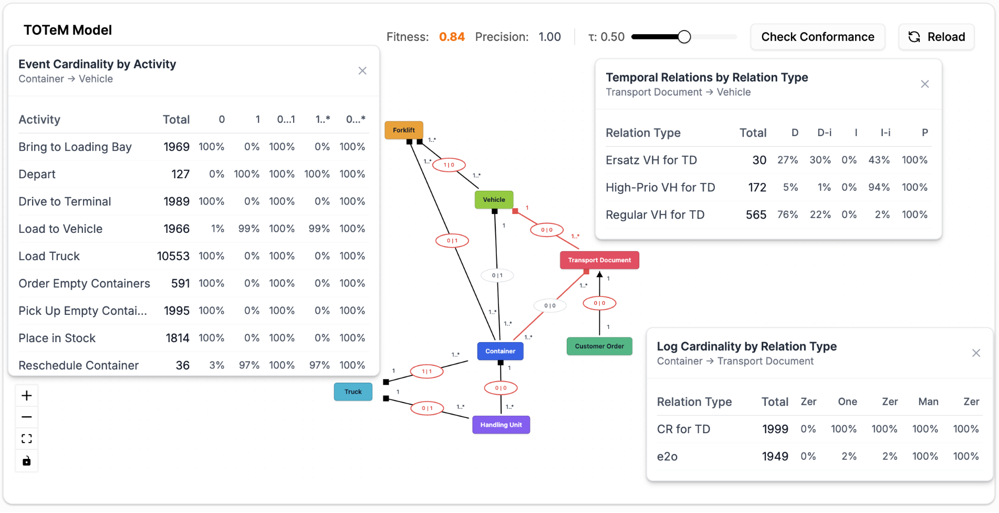

# TOTeM Conformance

[← Back to the README](../../README.md#-features)

**TOTeM conformance checking** compares an event log with a TOTeM model: a model you
[discovered](totem-discovery.md) earlier, one you drew in the [TOTeM editor](editors.md), or one you
uploaded. It measures how well the temporal relations and cardinalities observed in the log fit the
model. Typical questions are "Does every container still belong to exactly one transport document?"
or "Is a vehicle always booked before the containers are loaded?"

## Where to find it

- **Conformance → TOTeM Conformance**
- **Project Assets → Model Assets**: the *Use for conformance* action on a TOTeM model opens this
  view with the model preselected.

## How to use it

1. Select a stored TOTeM model from the [Project Asset Store](project-asset-store.md).
2. Start the conformance check. The current event log is used, including the global filter if it
   is active.
3. Read the overall **fitness** (how much of the log's behavior the model allows) and
   **precision** (how much of the model's behavior actually occurs in the log). The model is
   colored by conformance, so problematic object types and relations stand out.
4. Select an object type or a relation to see the details. For each of the three dimensions of a
   TOTeM model, a table shows how the observations in the log are distributed:
   - **Temporal relations** (for example *during*, *precedes*, *parallel*),
   - **Log cardinality** (how many related objects an object has over its lifetime),
   - **Event cardinality** (how many objects take part in each event, per activity).
