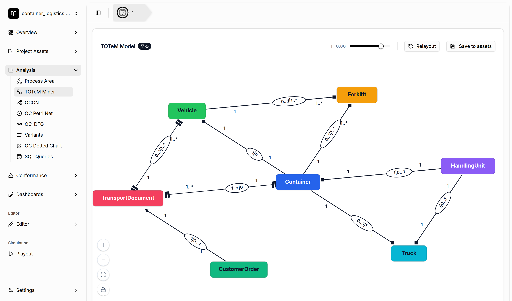

# TOTeM Discovery

[← Back to the README](../../README.md#-features)

The **TOTeM Miner** discovers a *Temporal Object Type Model* (TOTeM) from an object-centric event
log. A TOTeM model shows how the object types of a process relate to each other in **time** and in
**cardinality**. It gives you a compact, high-level description of how the objects of a process
interact.

## Where to find it

- **Analysis → TOTeM Miner**
- **Dashboards**: add the *TOTeM Miner* widget.

## How to read the model

Every node is an **object type**. For every pair of related object types, the miner compares the
lifespans of the related objects and records:

- **Temporal relation**, shown by the arc style:
  - *during / dependent*: the lifespan of one object type lies within the lifespan of the other.
  - *precedes / initiating*: one object type's lifespans end before the other's begin.
  - *parallel*: there is no temporal constraint.
- **Log cardinality**, shown as the text near the end of an arc (for example `1`, `1..*`):
  how many related objects of the other type an object has over its whole lifetime.
- **Event cardinality**, shown in the oval in the middle of an arc (for example `0...1|1..*`):
  how many objects of each type take part in a single event together.

## Controls

- **τ slider**: the noise threshold. A relation is only shown if it holds for at least a share
  τ of the related objects. Lower τ shows more (and noisier) relations; higher τ shows only the
  dominant ones.
- **Relayout**: recomputes the automatic layout.
- **Save to assets**: stores the discovered model in the [Project Asset Store](project-asset-store.md).
  From there, you can refine it in the [TOTeM editor](editors.md) or use it for
  [TOTeM conformance checking](totem-conformance.md).
- The filter badge next to the title turns the global filter on or off for this view.
