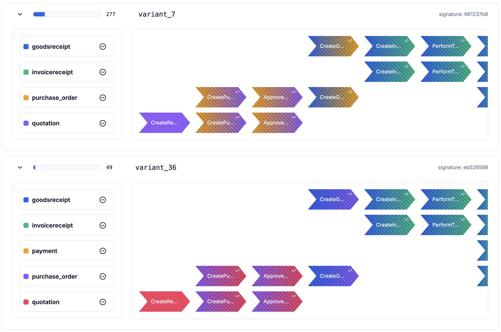
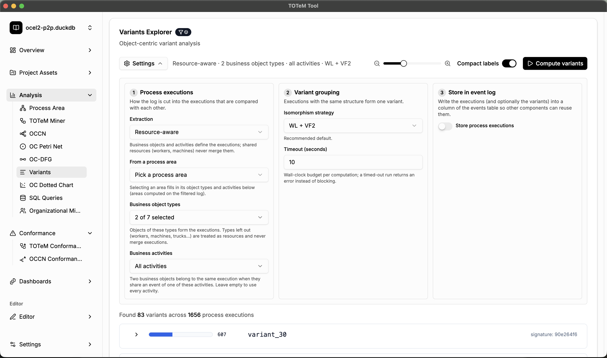

# Object-Centric Variant Discovery

[← Back to the README](../../README.md#-features)

In classical process mining, a variant is a unique sequence of activities. In object-centric
process mining, a single **process execution** involves several interacting objects, so a variant
is a unique *graph* of events and objects. The **Variants Explorer** cuts the log into process
executions, groups executions with the same structure into variants, and shows how often each
variant occurs.

## Where to find it

- **Analysis → Variants**
- **Dashboards**: add the *Variants Explorer* widget.

## Reading a variant

Every variant card shows its frequency (the bar and the count), its name, and a signature. Each
lane is one object of the execution, and the legend on the left gives the object types. Every
chevron is an event. Events shared by several objects are drawn in all involved lanes with the
colors of all involved object types. Use the zoom slider and the **Compact labels** switch to fit
large variants on the screen.

## Settings

Click **Settings** to configure the three steps of the computation:

1. **Process executions**: how the log is cut into executions.
   - *Leading type (1-hop or BFS)*: one execution per object of a chosen leading object type.
   - *Connected components*: one execution per connected component of the object graph.
   - *Resource-aware*: you choose the business object types (and optionally the business
     activities) that define the executions. Shared resources such as workers or machines never
     merge executions. You can also start from a discovered
     [process area](process-area-discovery.md).
2. **Variant grouping**: the isomorphism strategy that decides when two executions have the same
   structure. *WL + VF2* is the recommended default; faster but less exact strategies are available
   for large logs. A timeout keeps the computation bounded.
3. **Store in event log**: optionally writes the execution id (and the variant id) of every event
   into a new column of the log. Other components reuse these columns, for example
   [OCCN conformance checking](occn-conformance.md) on stored process executions or your own
   [SQL queries](sql-queries.md).

Then click **Compute variants**.
